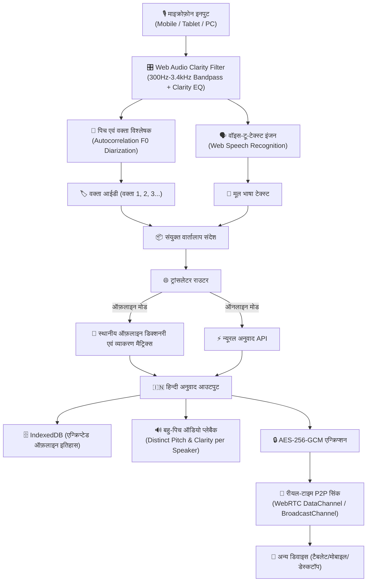

# भाषा सेतु (BhashaSetu) - परियोजना योजना एवं तकनीकी रूपरेखा (Project Plan & Architecture)

**भाषा सेतु (BhashaSetu)**: एक सार्वभौमिक (Universal), ऑफ़लाइन-सक्षम (Offline-Capable), मल्टी-स्पीकर वॉयस अनुवादक एवं रीयल-टाइम डेटा सिंक्रोनाइज़ेशन प्लेटफ़ॉर्म जो किसी भी भाषा का हिन्दी में सटीक अनुवाद करता है।

---

## 1. परियोजना का उद्देश्य एवं विजन (Executive Summary)

आधुनिक डिजिटल युग में विभिन्न भाषाओं में संवाद करते समय भाषाई बाधा, अस्थिर इंटरनेट कनेक्टिविटी, और बहु-वक्ता (multi-speaker) सम्मेलनों में आवाजों की अस्पष्टता सबसे बड़ी चुनौतियां हैं। 
**भाषा सेतु** इन सभी समस्याओं का समाधान एक ही सरल, सुंदर और सुरक्षित वेब उपकरण में प्रस्तुत करता है जो:
- **टैबलेट, मोबाइल और डेस्कटॉप** पर सहज और उत्तरदायी (Responsive) रूप से कार्य करता है।
- **किसी भी भाषा (अंग्रेजी, स्पेनिश, फ्रेंच, जर्मन, अरबी, रूसी, चीनी, जापानी, तमिल, तेलुगु, बंगाली, मराठी आदि) का अनुवाद हिन्दी में** करता है।
- **वॉइस-टू-टेक्स्ट (Voice-to-Text / Speech Recognition)** के माध्यम से रीयल-टाइम में बोले गए शब्दों को टेक्स्ट में बदलता है।
- **100% ऑफ़लाइन कार्य करने में सक्षम** है (PWA सर्विस वर्कर + लोकल डिक्शनरी एवं ट्रांसलेशन मैट्रिक्स + IndexedDB)।
- **बहु-वक्ता पहचान एवं स्पष्ट ऑडियो (Multi-Speaker Diarization & Audio Clarity)**: जब कई लोग बोल रहे हों, तो प्रत्येक वक्ता (वक्ता 1, वक्ता 2, आदि) की आवाज़ को पिच (Pitch) और स्पेक्ट्रल विश्लेषण द्वारा अलग पहचानता है तथा अनुवाद सुनाते समय भिन्न-भिन्न पिच और ध्वनि प्रोफाइल में सुनाता है ताकि हर व्यक्ति की आवाज़ स्पष्ट और अलग लगे।
- **रीयल-टाइम डेटा सिंक्रोनाइज़ेशन (Real-Time Sync)**: विभिन्न उपकरणों (फ़ोन, टैबलेट, पीसी) के बीच P2P WebRTC और स्थानीय रूम सिंक द्वारा तात्कालिक वार्तालाप साझा करता है।
- **एंड-टू-एंड एन्क्रिप्शन (E2EE)**: डेटा सुरक्षा के लिए Web Crypto API (AES-256-GCM + PBKDF2) का उपयोग करता है जिससे सर्वर या तीसरे पक्ष तक कोई भी अनएन्क्रिप्टेड डेटा नहीं पहुंचता।

---

## 2. तकनीकी स्टैक (Technology Stack)

| घटक (Component) | प्रयुक्त तकनीक (Technology) | उद्देश्य एवं लाभ |
|---|---|---|
| **Frontend Framework & UI** | Semantic HTML5, Modern CSS3, Tailwind CSS, Lucide Icons | मोबाइल, टैबलेट और डेस्कटॉप पर फ्लूइड रिस्पॉन्सिव लेआउट, डार्क/लाइट मोड |
| **Typography** | Noto Sans Devanagari, Inter, Poppins | स्वच्छ, सुंदर एवं आसानी से पढ़ी जाने वाली हिन्दी लिपि |
| **PWA & Offline Core** | Service Worker (Cache API), Web App Manifest | बिना इंटरनेट के पूर्ण संचालन, होम स्क्रीन पर इंस्टॉल करने की सुविधा |
| **Voice-to-Text (STT)** | Web Speech API (`SpeechRecognition`), Web Audio API VAD | उच्च परिशुद्धता रीयल-टाइम वॉइस ट्रांसक्रिप्शन |
| **ऑडियो स्पष्टता एवं विश्लेषण** | Web Audio API (`AudioContext`, `BiquadFilterNode`, `AnalyserNode`) | वोकल स्पष्टता बूस्ट (Bandpass/Peaking 300Hz-3400Hz), बैकग्राउंड नॉइज़ सप्रेशन |
| **बहु-वक्ता पृथक्करण (Diarization)** | Time-Domain Autocorrelation Pitch ($F_0$) Extraction, Spectral Centroid | विभिन्न वक्ताओं की पिच प्रोफाइल पहचानना, रंगीन बैज व अलग वक्ता टैग |
| **बहु-ध्वनि प्लेबैक (TTS)** | `SpeechSynthesisUtterance` Dynamic Modulation | प्रत्येक वक्ता के लिए भिन्न पिच (0.75 - 1.25), गति और ध्वनि प्रोफाइल |
| **अनुवाद इंजन (Translation)** | Dual-Engine: 1) Offline Rule & Matrix Dictionary Engine + 2) Online Neural API Fallback | बिना इंटरनेट के तुरंत अनुवाद + ऑनलाइन होने पर उच्च गुणवत्ता बैकअप |
| **रीयल-टाइम सिंक** | WebRTC DataChannels + BroadcastChannel + Room Code Pairing | बिना केंद्रीय सर्वर के उपकरणों के बीच तात्कालिक P2P सिंक |
| **सुरक्षा एवं एन्क्रिप्शन** | Web Crypto API (`AES-256-GCM`, `PBKDF2`, `SHA-256`) | 256-बिट एंड-टू-एंड एन्क्रिप्शन, सुरक्षा फिंगरप्रिंट |
| **लोकल स्टोरेज** | IndexedDB (Client-Side Storage) | ऑफ़लाइन सत्र, अनुवाद इतिहास और सेटिंग्स का एन्क्रिप्टेड भंडारण |

---

## 3. वास्तुशिल्प एवं डेटा प्रवाह (Architecture & Data Flow)



---

## 4. प्रमुख विशेषताओं का विवरण (Core Feature Specifications)

### 4.1. सार्वभौमिक क्रॉस-प्लेटफ़ॉर्म रिस्पॉन्सिव यूआई (Universal Responsive UI)
- **मोबाइल (320px - 640px)**: एक हाथ से संचालन के अनुकूल बॉटम नेविगेशन, बड़े स्पर्श योग्य बटन (Touch-friendly 48px+ targets), सहज ड्रॉअर मेनू।
- **टैबलेट (641px - 1024px)**: स्प्लिट-व्यू (बाएं तरफ वक्ता और वॉइस इनपुट, दाएं तरफ रीयल-टाइम हिन्दी अनुवाद एवं सिंक पैनल)।
- **डेस्कटॉप (1025px+)**: व्यापक मल्टी-कॉलम डैशबोर्ड, रीयल-टाइम ऑडियो विज़ुअलाइज़र (ऑसिलोस्कोप और स्पेक्ट्रम), पूर्ण इतिहास और उन्नत एन्क्रिप्शन सेटिंग्स।
- **PWA क्षमता**: क्रोम, सफारी, एज, फायरफॉक्स और एंड्रॉइड/आईओएस पर सीधे 'Add to Home Screen' के जरिए इंस्टॉल करने योग्य।

### 4.2. बहु-वक्ता पहचान एवं विशिष्ट आवाज़ स्पष्टता (Multi-Speaker Diarization & Audio Separation)
1. **ध्वनि स्पष्टता फ़िल्टर (Speech Clarity Enhancement)**:
   - Web Audio API के `BiquadFilterNode` का उपयोग करके 300Hz से कम की अवांछित घड़घड़ाहट (rumble) और 3400Hz से अधिक की फुसफुसाहट (high hiss) को काटा जाता है।
   - भाषण की स्पष्टता के लिए वोकल फॉर्मैंट्स (1.5kHz - 2.8kHz) में +3dB से +5dB का पीक दिया जाता है जिससे शोर भरे माहौल में भी शब्द स्पष्ट सुनाई दें।
2. **पिच-आधारित वक्ता पृथक्करण (Pitch-Based Speaker Diarization)**:
   - माइक्रोफ़ोन इनपुट का रीयल-टाइम ऑटो-कोरिलेशन विश्लेषण करके फंडामेंटल फ्रीक्वेंसी ($F_0$) की गणना की जाती है।
   - भिन्न पिचों और समय अंतराल (pause intervals) के आधार पर प्रणाली स्वचालित रूप से नए वक्ता की पहचान करती है।
   - उपयोगकर्ता आवश्यकतानुसार स्क्रीन पर एक टैप से वक्ता (वक्ता 1, वक्ता 2, वक्ता 3 आदि) बदल सकते हैं।
3. **श्रव्य रूप से अलग आवाज़ में प्लेबैक (Audibly Distinct TTS Playback)**:
   - जब अनुवाद हिन्दी में सुनाया जाता है, तो प्रत्येक वक्ता के लिए आवाज़ की पिच और गति अलग रखी जाती है:
     - **वक्ता 1 (गंभीर/गहरी आवाज़)**: Pitch = 0.85, Rate = 0.95 (एमराल्ड ग्रीन थीम)
     - **वक्ता 2 (मध्यम/स्पष्ट आवाज़)**: Pitch = 1.05, Rate = 1.00 (रॉयल ब्लू थीम)
     - **वक्ता 3 (तीखी/ऊंची आवाज़)**: Pitch = 1.25, Rate = 1.05 (वायलेट/पर्पल थीम)
     - **वक्ता 4 (ऊर्जावान आवाज़)**: Pitch = 0.70, Rate = 1.10 (ऐम्बर/ऑरेंज थीम)
   - इससे सुनने वाले को आंखें बंद करके भी स्पष्ट पता चलता है कि कौन सा वक्ता क्या बोल रहा है।

### 4.3. ऑफ़लाइन एवं ऑनलाइन अनुवाद आर्किटेक्चर (Hybrid Translation Engine)
- **ऑफ़लाइन इंजन (100% Client-Side)**:
  - 15+ प्रमुख भाषाओं के लिए इन-मेमोरी वोकैबुलरी, रूट-वर्ड मैपर और फ़्रेज़ डिक्शनरी।
  - सामान्य वाक्यों, अभिवादनों, प्रश्नों और तकनीकी/दैनिक वार्तालाप के लिए सटीक हिन्दी अनुवाद।
  - फ़ोनेटिक देवनागरी ट्रांसलिट्रेशन इंजन (रोमन लिपि से देवनागरी में त्वरित रूपांतरण)।
  - उपयोगकर्ताओं के लिए अपनी कस्टम डिक्शनरी और शब्द जोड़ने की सुविधा।
- **ऑनलाइन न्यूरल फ़ालबैक**:
  - इंटरनेट उपलब्ध होने पर उच्च-स्तरीय न्यूरल अनुवाद API से ऑटो-फ़ॉलबैक।

### 4.4. रीयल-टाइम डेटा सिंक्रोनाइज़ेशन (Real-Time Synchronization)
- **WebRTC DataChannels**: दो या अधिक उपकरणों के बीच सीधा पीयर-टू-पीयर (P2P) कनेक्शन।
- **लोकल ब्रॉडकास्ट चैनल**: एक ही डिवाइस में अलग-अलग ब्राउज़र टैब या विंडो के बीच शून्य-विलंबता सिंक।
- **कमरे का कोड / क्यूआर कोड (Room Pairing)**: उपयोगकर्ता 6-अंकों का रूम कोड दर्ज करके या क्यूआर कोड शेयर करके एक ही वार्तालाप सत्र में जुड़ सकते हैं।

### 4.5. एंड-टू-एंड एन्क्रिप्शन (End-to-End Encryption - E2EE)
- **एन्क्रिप्शन मानक**: AES-GCM (Galois/Counter Mode) 256-बिट।
- **कुंजी व्युत्पत्ति (Key Derivation)**: PBKDF2 (Password-Based Key Derivation Function 2) 100,000 पुनरावृत्तियों और SHA-256 हैशिंग के साथ।
- **सुरक्षा सत्यापन**: प्रत्येक सत्र के लिए 12-बाइट रैंडम IV और SHA-256 फ़िंगरप्रिंट प्रदर्शित होता है, ताकि उपयोगकर्ता सुरक्षा कोड सत्यापित कर सकें।
- कोई भी प्लेनटेक्स्ट नेटवर्क पर या सर्वर पर नहीं भेजा जाता।

---

## 5. फ़ाइल संरचना (Repository Structure)

```
bhasha-setu/
├── index.html                 # मुख्य एकल-पृष्ठ वेब ऍप्लिकेशन (रिस्पॉन्सिव लेआउट)
├── manifest.json              # PWA मैनिफ़ेस्ट (मोबाइल/टैबलेट इंस्टॉलेशन के लिए)
├── sw.js                      # सर्विस वर्कर (100% ऑफ़लाइन कैचिंग)
├── css/
│   └── style.css              # कस्टम रिस्पॉन्सिव स्टाइल, ऑडियो वेव एनिमेशन, थीम्स
├── js/
│   ├── app.js                 # मुख्य ऍप्लिकेशन लॉजिक, टैब कंट्रोल, यूआई बाइंडिंग
│   ├── stt.js                 # वॉइस-टू-टेक्स्ट और माइक्रोफ़ोन इनपुट हैंडलर
│   ├── audio-clarity.js       # वेब ऑडियो EQ, पिच विश्लेषण, वक्ता डायराइज़ेशन
│   ├── translator.js          # ऑफ़लाइन मल्टीलिंगुअल-टू-हिन्दी इंजन व ऑनलाइन फ़ालबैक
│   ├── tts.js                 # बहु-वक्ता अलग-अलग पिच टेक्स्ट-टू-स्पीच प्लेबैक
│   ├── crypto.js              # Web Crypto AES-256-GCM एंड-टू-एंड एन्क्रिप्शन
│   ├── sync.js                # रीयल-टाइम P2P एवं ब्रॉडकास्ट सिंक
│   └── storage.js             # IndexedDB ऑफ़लाइन सुरक्षित डेटाबेस
├── data/
│   └── offline-dictionary.json # व्यापक बहुभाषी ऑफ़लाइन शब्दकोश
├── icons/
│   ├── icon-192.png           # PWA आइकॉन (192x192)
│   └── icon-512.png           # PWA आइकॉन (512x512)
├── PLAN.md                    # विस्तृत परियोजना योजना (यह फ़ाइल)
└── README.md                  # विस्तृत उपयोगकर्ता एवं विकास गाइड
```

---

## 6. कार्यान्वयन एवं परीक्षण योजना (Implementation & Testing Roadmap)

1. **चरण 1: कोर स्ट्रक्चर एवं PWA सेटअप**:
   - रिस्पॉन्सिव HTML लेआउट (मोबाइल, टैबलेट, डेस्कटॉप ग्रिड)।
   - सर्विस वर्कर और ऑफ़लाइन मैनिफ़ेस्ट का एकीकरण।
2. **चरण 2: वॉइस-टू-टेक्स्ट एवं ऑडियो क्लैरिटी इंजन**:
   - Web Speech API निरंतर पहचान।
   - Web Audio API बैंडपास फ़िल्टर एवं पिच डिटेक्टर।
   - वक्ता विभाजन (Speaker 1, 2, 3...) और अलग-अलग आवाज़ प्लेबैक।
3. **चरण 3: बहुभाषी से हिन्दी अनुवाद इंजन**:
   - ऑफ़लाइन डिक्शनरी मैट्रिक्स और नियम-आधारित ट्रांसलेटर।
   - ऑनलाइन न्यूरल API बैकअप।
4. **चरण 4: एंड-टू-एंड एन्क्रिप्शन और रीयल-टाइम सिंक**:
   - AES-256-GCM सिंक पैकेट्स और IndexedDB स्टोरेज।
   - रूम कोड आधारित P2P ब्रॉडकास्टिंग।
5. **चरण 5: सत्यापन, गिटहब रेपो निर्माण और डिप्लॉयमेंट**:
   - गिटहब API से नया रिपॉजिटरी बनाना।
   - कोड कमिट एवं रिमोट पुश।

---

## 7. निष्कर्ष (Conclusion)

यह उपकरण भाषा, स्थान और इंटरनेट की सीमाओं से परे जाकर किसी भी व्यक्ति को हिन्दी में निर्बाध, स्पष्ट, सुरक्षित और बहु-वक्ता संवाद की सुविधा प्रदान करता है।
